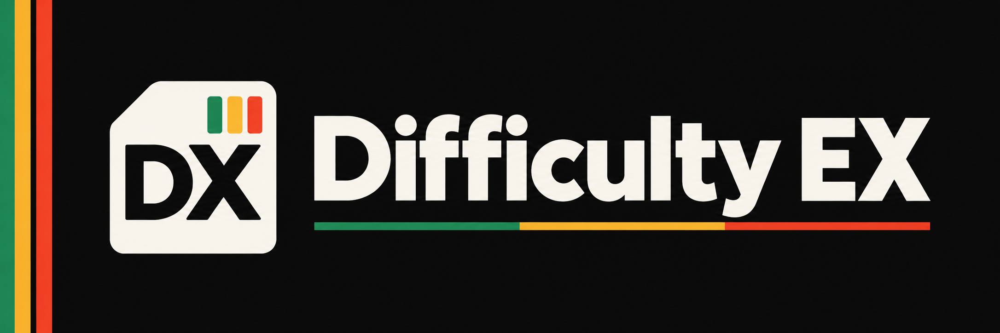

<div align="center">



[](LICENSE)
[](https://github.com/BareMinimumStudios/difficultyex/actions/workflows/build.yml)
[](https://github.com/BareMinimumStudios/difficultyex/issues)

**Minecraft 1.21.1 · Fabric + NeoForge · Java 21**

[Modrinth](https://modrinth.com/mod/qdJ4GLvL) · [CurseForge](https://www.curseforge.com/minecraft/mc-mods/difficultyex) · [Documentation](docs/README.md) · [Community](https://discord.gg/pcRw79hwey)

</div>

## Make the world grow with your players

DifficultyEx adds configurable MMORPG-style mob levels built around PlayerEx. Set gentler limits for a starting biome, raise the stakes in the Nether, or give a dungeon its own level range.

Nearby players' progression helps determine new mob levels. Health, armor, attack damage and XP rewards scale with those levels. Optional nameplates show what players are facing.

**The 1.21.1 port is in development.** Packaged server startup, commands and save/restart checks pass on both loaders. Multiplayer, visual edge cases and broader gameplay acceptance remain pending. Download pages also contain older releases; choose the correct Minecraft version and loader.

## What you can configure

| Feature | Your controls |
| --- | --- |
| Player progression | PlayerEx level formula, nearby-player radius and random variation |
| Areas | Minimum and maximum levels by dimension, biome and loaded structure |
| Individual mobs | Entity IDs, regular expressions and a scaling blacklist |
| Combat and rewards | Health, armor, attack damage and XP rates |
| Nameplates | Level, health bar, HP text, range, hostile-only display and blacklist |

Mobs keep their assigned level when saved and reloaded. Server gameplay settings and client nameplate preferences are separate.

## Install

Use **Minecraft 1.21.1 and Java 21**, with **Fabric Loader 0.20+** for Fabric. Install the matching DifficultyEx build and dependencies on the server and clients.

| Both loaders | Fabric also needs | NeoForge also needs |
| --- | --- | --- |
| [PlayerEx](https://modrinth.com/mod/4UKlJSdk), [Data Attributes](https://modrinth.com/mod/KCGxOJsE), [Fzzy Config](https://modrinth.com/mod/VSNURh3q), Remnant available through PlayerEx | [Fabric API](https://modrinth.com/mod/P7dR8mSH), [Fabric Language Kotlin](https://modrinth.com/mod/Ha28R6CL) | [Kotlin for Forge](https://modrinth.com/mod/kotlin-for-forge) |

See [installation and tested dependency versions](docs/INSTALLATION.md). The 1.21.1 port no longer requires owo-lib.

## Configure your world

Settings live in `config/difficultyex/config.json5`. Edit the file while the game or server is stopped, then restart. You can also use Fzzy Config's optional `/configure difficultyex` editor in-game. Choose **Changes > Apply Changes** to save edits.

For example, make the Nether start at level 20 and cap it at 60:

```json5
dimensionStartingLevels: { "minecraft:the_nether": 20 },
dimensionMaximumLevels: { "minecraft:the_nether": 60 },
```

Merge those entries into the existing maps. [Configuration reference and examples](docs/CONFIGURATION.md) explain all settings, rule priority and structure loading.

## Operator tools

All administration commands require permission level 2.

| Command | Purpose |
| --- | --- |
| `/difficultyex validate` | Check active rules, entity patterns and formula syntax |
| `/difficultyex inspect <target>` | Read a mob's level, health and combat attributes |
| `/difficultyex set <target> <level>` | Change a mob's level while preserving its health percentage |

See [commands and selectors](docs/COMMANDS.md).

## Find your way around

- [Documentation hub](docs/README.md)
- [Installation](docs/INSTALLATION.md) · [Configuration](docs/CONFIGURATION.md) · [Commands](docs/COMMANDS.md)
- [Upgrading from 1.20.1](docs/MIGRATION.md) · [Compatibility and limitations](docs/COMPATIBILITY.md)
- [Development](DEVELOPMENT.md) · [Testing and port status](docs/PORT_STATUS.md) · [Changelog](CHANGELOG.md)
- [CurseForge page copy](docs/CURSEFORGE.md) · [Modrinth page copy](docs/MODRINTH.md) · [Brand assets](docs/BRANDING.md)
- [Report an issue](https://github.com/BareMinimumStudios/difficultyex/issues) · [Bare Minimum Studios](https://github.com/BareMinimumStudios) · [Discord](https://discord.gg/pcRw79hwey)

Code and artwork use [The Bare Minimum License v1.0](LICENSE). The [inherited MIT notice](docs/ORIGINAL_MIT_LICENSE.txt) is retained for historical portions.
