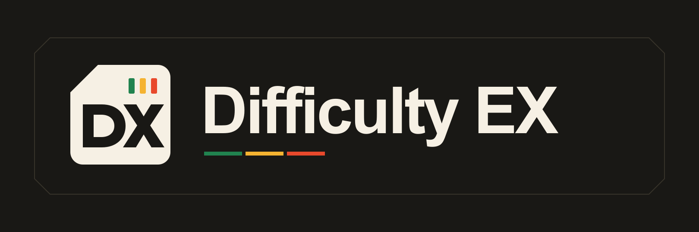

<strong>Minecraft 1.21.1 · Fabric + NeoForge · Java 21</strong>

DifficultyEx gives your world RPG-style mob levels that grow with nearby players' **PlayerEx progression**. Build a forgiving starter biome, a tougher Nether, or a dungeon with its own level range.

## Features

- **Scale mobs with your players.** Tune the nearby-player radius, level formula, and random variation. Mobs keep their assigned level through saves and restarts.
- **Set rules for areas and mobs.** Define level floors and caps by dimension, biome, loaded structure, or mob type. Exclude specific mobs from initial scaling.
- **Tune combat and rewards.** Scale maximum health, armor, melee attack damage, and base XP rewards independently.
- **Show the stats you care about.** Optional client-side nameplates show mob level, a health bar, and current and maximum HP. Set display range, show only hostile mobs, or hide specific mob types.

## Installation

Install matching DifficultyEx builds and dependencies on each client and on the server for multiplayer. Both loaders need PlayerEx, Data Attributes, and Fzzy Config. The tested PlayerEx build includes Remnant.

- **Fabric:** Fabric Loader 0.20+, Fabric API, and Fabric Language Kotlin.
- **NeoForge:** The complete Kotlin for Forge distribution.

[Installation guide and tested versions](https://github.com/BareMinimumStudios/difficultyex/blob/1.21.1/docs/INSTALLATION.md)

## Configuration and commands

Edit `config/difficultyex/config.json5` while the game or server is stopped, then restart. In game, use `/configure difficultyex` and select **Changes > Apply Changes**. The server controls scaling, and each client controls its nameplates.

Operators can use `/difficultyex validate` to check settings, `/difficultyex inspect <target>` to view a mob's stats, and `/difficultyex set <target> <level>` to change its level while preserving its health percentage.

[Configuration and examples](https://github.com/BareMinimumStudios/difficultyex/blob/1.21.1/docs/CONFIGURATION.md) · [Operator commands](https://github.com/BareMinimumStudios/difficultyex/blob/1.21.1/docs/COMMANDS.md) · [Changelog](https://github.com/BareMinimumStudios/difficultyex/blob/1.21.1/CHANGELOG.md) · [Discord](https://discord.gg/pcRw79hwey) · [License](https://github.com/BareMinimumStudios/difficultyex/blob/1.21.1/LICENSE)

## Sponsor

Use code **`bareminimum`** to get **25% off your first month**!
